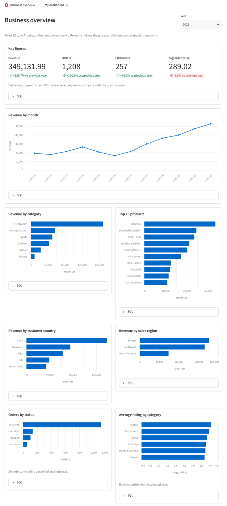

# SQL Chat Assistant v2: a text-to-SQL agent you can measure

**[▶ Live demo](https://sql-chat-assistant-diwakar.streamlit.app/)** · Benchmark: 64.4% → **100%** execution accuracy (gpt-oss-120b, 45 questions)

Ask a database questions in plain English. The agent writes SQLite, checks that the query is safe, runs it read-only and fixes its own mistakes. A benchmark measures how often it gets the answer right.

**v1** wrapped LangChain's `create_sql_agent`. It worked, but I couldn't measure how well, or explain why it failed.
**v2** replaces it with a small agent loop I wrote myself. It also comes with a 45-question benchmark that shows what each part of the agent adds.

## How the agent works

```
question
  │
  ├─ 1. Schema linking ─── score tables by overlap with the question, add FK join tables
  ├─ 2. Prompt ─────────── CREATE TABLE DDL + sample rows + business glossary + few-shot
  ├─ 3. Generate SQL ───── Groq-hosted model (default openai/gpt-oss-120b), temperature 0
  ├─ 4. Guard ──────────── sqlglot parse: exactly one SELECT, no DML/DDL/PRAGMA/ATTACH ──┐
  ├─ 5. Execute ────────── SQLite opened mode=ro, 10s timeout, 1,000-row cap ────────────┤ error → fed back
  ├─ 6. Empty-result check  0 rows? ask the model to re-check filters once               │ to the model,
  └─ 7. Answer + full trace (every SQL attempt, error, token count, latency)     ◄────────┘ up to 3 repairs
```

| File | What it does |
|---|---|
| `sqlagent/agent.py` | Agent loop and the 4 configurations the benchmark compares |
| `sqlagent/schema.py` | Reads the schema, renders the prompt and picks the relevant tables (schema linking) |
| `sqlagent/guard.py` | Checks the SQL before it runs (AST-based, not regex) |
| `sqlagent/executor.py` | Runs the query read-only, with a timeout and a row cap |
| `sqlagent/prompts.py` | Prompts. The few-shot examples use a *different* schema, so they can't leak benchmark answers |
| `sqlagent/llm.py` | Groq client with rate-limit backoff, plus a scripted client for offline tests |
| `sqlagent/viz.py` | Picks a chart from the result's shape: number tiles, line, bar or scatter |
| `sqlagent/dashboard.py` | Loads, checks and runs dashboards (JSON lists of SQL tiles) |

**Safety is layered.** A `DELETE` gets past the guard only if the guard has a bug. Even then, the connection is opened read-only (`mode=ro` + `PRAGMA query_only`), so the write fails. The test suite checks this by running a `DELETE` with the guard skipped.

## Dashboards



- **Automatic charts:** every answer gets a chart that fits its result. One row of numbers becomes number tiles, a date column becomes a line chart, and a label column with values becomes a sorted bar chart (grouped bars when several values share a scale). Two number columns become a scatter plot. A revenue figure and a growth % are never put on the same axis.
- **Business overview:** a ready-made dashboard (`dashboards/overview.json`) with a year filter and key figures showing the change from the previous year. It runs fixed SQL with no AI calls, so it still works when the model quota is used up. Its revenue matches the benchmark's correct answer exactly, and a test checks this.
- **My dashboard:** click **📌 Pin to dashboard** under any answer to add it. You can export the dashboard as JSON and import it again later.
- **Same safety rules:** every dashboard tile goes through the same SQL check and read-only connection as the agent's queries. An imported dashboard containing `DELETE` or `DROP` is rejected.

## The benchmark

`bench/retail.db` is a seeded, fully reproducible e-commerce database. It has 7 tables: customers, orders, order_items, products, categories, employees (with a manager hierarchy) and reviews. There are about 2,200 orders spread over 2023–2025.

`bench/questions.json` holds 45 questions, each with a hand-written gold SQL query:

| Tier | n | Covers |
|---|---|---|
| easy | 15 | filters, counts, simple aggregates, one join |
| medium | 18 | multi-table joins, GROUP BY/HAVING, NOT EXISTS, business metrics, percentages |
| hard | 12 | window functions (LAG, RANK, running totals), CTEs, self-joins, top-N per group, cohort-style logic |

**Business glossary.** Real questions use business words like "revenue" or "active customer", not column names. `bench/glossary.json` defines these terms once, for example: *revenue excludes cancelled and returned orders*. Without the definitions, the model has to guess, and that is one of the main ways real text-to-SQL systems fail.

**Metric: execution accuracy (EX).** A prediction counts as correct if it returns the same result as the gold query. The SQL text doesn't need to match. The comparison rules are in `bench/metrics.py`:
- numbers are rounded to 2 decimals
- column order doesn't matter, but extra or missing columns count as wrong
- row order is checked only for the 6 questions that ask for an ordering and have no ties in the sort column

**Ablations.** Each configuration adds one component, so the report shows what each one contributes:

| Config | Schema | Samples + glossary | Few-shot | Schema linking | Self-correction |
|---|---|---|---|---|---|
| `baseline` | full DDL | – | – | – | – |
| `context` | full | ✓ | – | – | – |
| `fewshot` | full | ✓ | ✓ | – | – |
| `full` | linked | ✓ | ✓ | ✓ | ✓ (3 repairs + empty check) |

The report also includes: how often the query executes, how many questions self-correction rescued, schema-linking recall (did the pruned schema keep every table the gold query needs?), average LLM calls, prompt tokens and latency.

### Results

Model `openai/gpt-oss-120b` on Groq, temperature 0. One complete run, all 45 questions scored for each config. Full report: [`bench/results/20261117-0923_groq_openai_gpt-oss-120b/report.md`](bench/results/20261117-0923_groq_openai_gpt-oss-120b/report.md)

| Config | Overall | Easy (15) | Medium (18) | Hard (12) | Avg prompt tokens |
|---|---|---|---|---|---|
| baseline | **64.4%** | 93.3% | 61.1% | 33.3% | 639 |
| context (+ sample rows, glossary) | **97.8%** | 100% | 100% | 91.7% | 1,378 |
| fewshot (+ examples) | **100%** | 100% | 100% | 100% | 1,891 |
| full (+ schema linking, self-correction) | **100%** | 100% | 100% | 100% | 1,571 |

**What the results show**

- **Business definitions, not SQL skill, were the biggest gap.** I read every SQL query the baseline got wrong. 14 of its 16 failures were valid SQL that answered the wrong business question. 13 summed revenue, units sold or profit over *all* orders, including cancelled and returned ones. One counted the regional managers as sales reps. Of the other two, one used `'Cancelled'` where the data stores `'cancelled'` (fixed by showing sample rows), and one was a real SQL error. Adding sample rows and the glossary raised accuracy from 64.4% to 97.8%.
- **Context can overreach.** With the glossary, the model applied the "delivered/shipped only" rule to h05, a question about *any* order, and got it wrong. The few-shot examples fixed this.
- **Schema linking saves tokens without losing accuracy.** `full` matches `fewshot` at 100% with 17% fewer prompt tokens (4.4 of 7 tables per prompt), and every table each gold query needs is kept.
- **Self-correction was never triggered.** gpt-oss-120b wrote no query that crashed. Self-correction is a safety net for weaker models and bigger schemas. The test suite checks that it works.
- **The benchmark is at its ceiling for this model.** Two configs score 100%, so it can't rank them. Separating them needs harder questions, a weaker model or Spider (see below).

Latency isn't compared: Groq's free tier rate-limits requests, so the timings mostly measure waiting.

## Run it

```bash
pip install -r requirements.txt
export GROQ_API_KEY=...                  # free key at console.groq.com

python bench/build_db.py                 # builds bench/retail.db (deterministic)
pytest                                   # 29 tests, no API key needed
python -m bench.evaluate                 # full benchmark: 4 configs × 45 questions
streamlit run app.py                     # chat, dashboards, agent trace, benchmark tab
```

To see which models your key can use:
`python -c "from groq import Groq; [print(m.id) for m in Groq().models.list().data]"`

Useful flags: `--configs baseline,full`, `--ids h01,h02`, `--limit 10`, `--model <groq-model-id>`, `--resume <run-folder>`.
**Groq free-tier limits.** The client handles two kinds:
- **Per-minute limits:** it waits for the time Groq asks for and retries.
- **Daily token limit:** a full run (4 configs × 45 questions with gpt-oss-120b) uses about 200k tokens, the free daily allowance. When the limit is hit, the run stops and saves what it has done. Questions that hit API errors are marked "not scored", so they never count against accuracy. The report prints the exact `--resume` command to finish the run later.

**Checking the harness without an API key:**
- `--llm oracle` replies with the gold SQL. The score must be 100%, which shows the comparison logic is consistent.
- `--llm noisy` returns a hallucinated column name on the first attempt and the correct SQL after an error. The baseline should fail those questions and `full` should recover them, which shows the self-correction path works.

These two are tests of the harness, not model results.

**Spider (public benchmark).** Download Spider, then:

```bash
python -m bench.spider_adapter --spider ./spider --n 200
python -m bench.evaluate --questions bench/questions_spider.json --configs baseline,full
```

## Benchmark changelog

- **v1.1:** h07 was ambiguous. Products launched in 2025 have no 2024 revenue, and the gold query counted them (0 × 3 = 0). gpt-oss-120b read "their 2024 revenue" as "had 2024 sales". The question now says so explicitly ("revenue in both 2024 and 2025"), and the gold query returns 10 rows instead of 13. Found by inspecting a consistent model "failure", which is why failures in the report should be read, not just counted.

## Deploy (Streamlit Community Cloud)

1. At share.streamlit.io, create an app: repo `Diwakar-Bobburi/SQL-Chat-Assistant`, branch `v2`, main file `app.py`.
2. Under **Advanced settings → Secrets**, add:
   ```toml
   GROQ_API_KEY = "your-key"
   DEMO_MAX_QUESTIONS = "10"
   ```
   `DEMO_MAX_QUESTIONS` limits how many questions each visitor can ask, so one visitor can't use up the free daily Groq quota. If the quota does run out, visitors see a friendly message instead of an error.

The demo database is built automatically on first start.

## Limitations

- 45 questions is small. A 2-question difference between configs is noise, so compare configs on Spider before claiming anything.
- I wrote both the gold queries and the glossary. On my own benchmark, the glossary gives the agent an advantage that real users' wording won't always match.
- Schema linking is lexical, not embedding-based. It works on a 7-table schema with descriptive names. A 200-table warehouse with cryptic names would need embeddings or an LLM to pick the tables.
- SQLite only. The guard and executor are dialect-specific.
